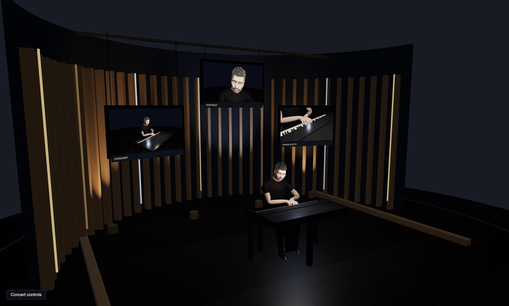
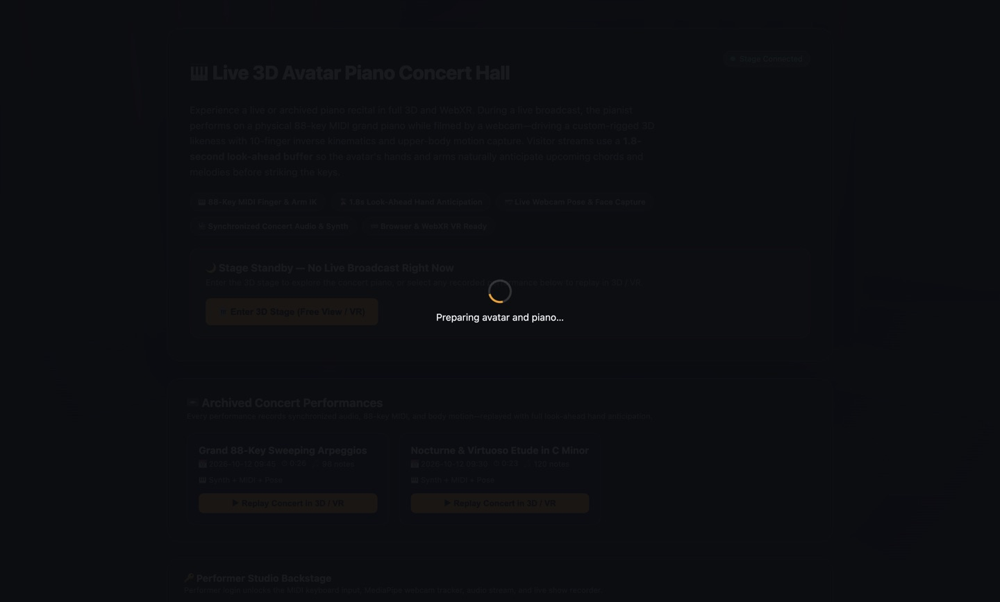
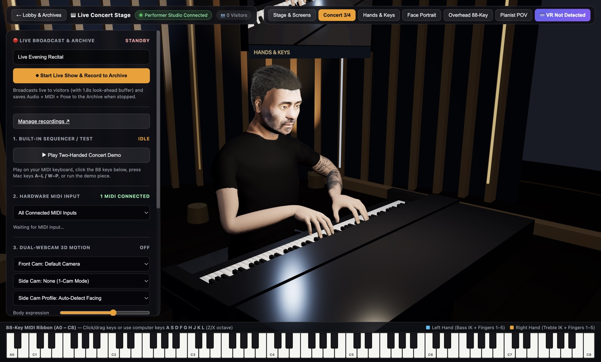
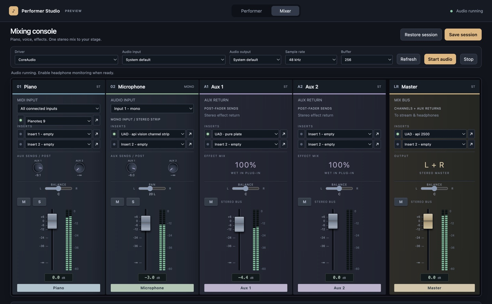

# 3D Piano Performances

A live 3D/WebXR piano concert stage. A pianist plays a MIDI keyboard. Visitors watch a rigged 3D avatar perform the same notes on an 88-key grand piano in their browser or VR headset, with synchronized audio, webcam-driven body and face motion, and a library of recorded performances to replay.

- **Visitors** open a web page. No account or install is needed. They watch live shows or replay archived ones in 3D or VR.
- **The performer** signs in backstage, connects a MIDI keyboard, webcams and audio, then starts a live show. Each show is recorded to the archive automatically.
- **Performer Studio** (optional desktop app for macOS and Windows) adds a native audio mixer with VST3 instruments and effects (for example Pianoteq and UAD), feeding the stage.



| Visitor lobby | Performer controls |
| --- | --- |
|  |  |

## What's in this repository

| Path | What it is |
| --- | --- |
| `server.py`, `archive_manager.py` | Python stage server: web pages, live WebSocket broadcast, performer sign-in, recording and archive management |
| `index.html`, `app.js`, `*.js` | The 3D stage (Three.js + WebXR), performer controls, MediaPipe tracking and replay engine |
| `concert_stage.glb`, `rig_calibration.json` | The avatar, piano and concert hall model, plus its hand/arm calibration |
| `setup/` | One-step setup and start scripts for the server (macOS, Linux, Windows) |
| `deploy/` | Docker Compose, Caddy and Nginx examples for hosting on the internet |
| `desktop-performer/` | Source for the Performer Studio desktop app (JUCE audio engine + Electron) |
| `docs/` | Setup guides |

## Quick start: run the stage on your computer

You need [Python 3.9 or later](https://www.python.org/downloads/).

**macOS / Linux**

```bash
./setup/setup-server.sh
./setup/run-server.sh
```

**Windows:** double-click `setup\setup-server.cmd`, then `setup\run-server.cmd`.

Open <http://localhost:8765>. The setup script prints your private performer password. Use it with **Performer Studio → Sign in** on the stage page.

## Performer Studio desktop app



## Guides

- [Server setup](docs/server-setup.md): local test, home server, Docker, HTTPS and putting the stage on the internet.
- [Performer setup](docs/performer-setup.md): MIDI keyboard, webcams, audio, going live and managing recordings.
- [Performer Studio desktop app](docs/desktop-studio.md): the native mixer for macOS and Windows, and building it from source.
- [Security](SECURITY.md): how sign-in, sessions and limits work.

## Browser support

Chrome or Edge on desktop is recommended. WebMIDI, webcams and WebXR work best there. Visitors can use any modern browser, and VR headsets with a WebXR browser (for example Meta Quest Browser) can enter the stage in VR.

## Avatar

This release ships with one avatar, created as a likeness of the project's author. Support for choosing between several avatars is planned. The stage expects a glTF binary with the `Matt_Rig` skeleton and `Matt_Mesh` names used in `app.js`, plus a matching `rig_calibration.json`. Those internal names are kept so existing recordings remain compatible.

## Tests

```bash
.venv/bin/python -m unittest discover -s tests -v      # server security and archive tests
node tests/replay-timing.mjs && node tests/stage-asset-cache.mjs   # Node 22+
```

## Licence

3D Piano Performances is free software under the [GNU Affero General Public License v3.0 or later](LICENSE) (AGPL-3.0-or-later). This covers the code and the bundled assets, including the avatar.

You may use, study, modify and share it. If you distribute it, or let people use a modified version over a network (for example by hosting your own stage), you must make your complete source code available under the same licence.

AGPL is the open-source licence offered by [JUCE](https://juce.com), which the Performer Studio audio engine is built on. Using it for the whole project keeps everything compatible. Bundled third-party components keep their own licences: JUCE (AGPLv3), the Steinberg ASIO headers (GPLv3, used here under that option), Electron (MIT) and Three.js (MIT, loaded from a CDN).
