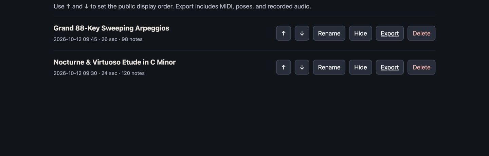

# Server setup

The stage server is a single Python program (`server.py`). It serves the 3D stage, relays the live show to visitors over WebSockets, handles performer sign-in and stores recordings in `archives/`. It runs on macOS, Linux and Windows, on a laptop, a home server or a small cloud VM.

## 1. Run it on your own computer (testing)

Requirements: Python 3.9+ ([download](https://www.python.org/downloads/); on Windows tick **Add python.exe to PATH**).

| | macOS / Linux | Windows |
| --- | --- | --- |
| Set up (once) | `./setup/setup-server.sh` | double-click `setup\setup-server.cmd` |
| Start | `./setup/run-server.sh` | double-click `setup\run-server.cmd` |

Setup asks three questions. Press Enter to accept the defaults for a local test:

1. **Port** (default `8765`).
2. **Public URL**: the exact address visitors type, without a path. For a local test keep `http://localhost:8765`.
3. **Performer name** shown on recordings.

It then:

- creates a private Python environment in `.venv` and installs `aiohttp`,
- generates a random **performer password** in `.performer-password` and prints it once. Save it in your password manager.
- writes your settings to `server.env`.

`.performer-password`, `server.env` and `archives/` are private and listed in `.gitignore`. Never commit them.

Open <http://localhost:8765>. You will see the lobby with two demo recordings.


 Click **Enter Performer Studio →** and sign in with the password.

Non-interactive setup (for scripts or servers):

```bash
./setup/setup-server.sh --origin https://stage.example.com --port 8765 --name "Your Name" --yes
```

```powershell
.\setup\setup-server.ps1 -Origin https://stage.example.com -Port 8765 -Name "Your Name" -Yes
```

To change a setting later, edit `server.env` or run setup again. Setup keeps the existing password; delete `.performer-password` first to generate a new one.

## 2. Settings reference

`run-server` loads `server.env` into these environment variables. You can also set them yourself.

| Variable | Default | Meaning |
| --- | --- | --- |
| `PORT` | `8765` | TCP port |
| `HOST` | `0.0.0.0` | Interface to listen on (`127.0.0.1` = this computer only, for use behind a reverse proxy) |
| `PUBLIC_ORIGIN` | `http://localhost:PORT` | Exact browser origin, e.g. `https://stage.example.com`. Sign-in and the live WebSocket reject other origins. |
| `PERFORMER_PASSWORD_FILE` | `.performer-password` | File containing the performer password (16+ characters) |
| `PERFORMER_PASSWORD` | – | Password given directly; takes precedence over the file. Prefer the file. |
| `PERFORMER_NAME` | `Pianist` | Performer name stored on recordings |
| `ARCHIVE_DIR` | `archives/` | Where recordings are saved |

Without a password, the stage and archives still work for visitors, but backstage sign-in is disabled.

## 3. Let other people watch

The **performer** needs either `localhost` or HTTPS. Browsers only allow webcams, MIDI and audio capture on secure pages. **Visitors** on your home network can use `http://<your-computer's-IP>:8765`, but anything on the internet should use HTTPS. Pick one of these options.

### Option A: Caddy (simplest HTTPS)

You need a domain name whose DNS points at your server, and ports 80/443 forwarded to it.

1. Install [Caddy](https://caddyserver.com/docs/install).
2. Copy `deploy/Caddyfile.example` to your Caddyfile and replace `stage.example.com` with your domain.
3. Run setup with `--origin https://your.domain`, and set `HOST=127.0.0.1` in `server.env` so only Caddy can reach the server.
4. Start the server and Caddy. Caddy obtains and renews the certificate itself.

### Option B: Nginx

Use `deploy/nginx.conf.example`, which includes the WebSocket upgrade headers. Get a certificate with certbot.

### Option C: Cloudflare Tunnel (no port forwarding)

Create a tunnel in the Cloudflare Zero Trust dashboard and add a public hostname whose service is `http://localhost:8765`. WebSockets work through the tunnel. Set `PUBLIC_ORIGIN` to the public hostname, e.g. `https://stage.example.com`.

### Serving under a path

The server answers on both `/` and `/piano/`, so you can route `https://example.com/piano/*` to it from a site that hosts other things. `PUBLIC_ORIGIN` is still just the origin (`https://example.com`).

## 4. Docker

```bash
./setup/setup-server.sh --yes                    # or create .performer-password yourself (16+ characters)
echo "PUBLIC_ORIGIN=https://stage.example.com" > deploy/.env
docker compose -f deploy/docker-compose.yml up -d --build
```

The password file is mounted as a Docker secret, and recordings are kept in the `piano-archives` volume. Put Caddy, Nginx or a tunnel in front for HTTPS as above.

## 5. Keep it running

- **Linux (systemd):** `./setup/setup-server.sh --service` installs and starts `piano-stage.service`. Then use `sudo systemctl status piano-stage` and `journalctl -u piano-stage -f`.
- **Windows:** `.\setup\setup-server.ps1 -StartAtLogon` registers a scheduled task that starts the server when you sign in. Allow the port in Windows Firewall when prompted.
- **macOS:** run `./setup/run-server.sh` in a Terminal tab, or wrap it in a launchd agent.

## 6. Recordings and backups

Every live show is saved to `ARCHIVE_DIR` as `session_*.json` (MIDI, body pose, timing) plus `session_*.webm` (audio). Signed-in performers can rename, hide, delete, restore, export and import recordings at `/archive-admin.html` (**Manage recordings ↗** in Performer Studio).



Back up the archive folder and `.performer-password`. Recordings are held in memory while a show runs (up to 256 MB), so leave a margin of RAM and keep an eye on disk space.

## Troubleshooting

| Symptom | Fix |
| --- | --- |
| Sign-in says *Origin not allowed* | `PUBLIC_ORIGIN` must match the address bar exactly: scheme, host and port, no trailing slash. |
| Sign-in returns 503 | No password configured; run setup, or check `PERFORMER_PASSWORD_FILE`. |
| *Set a unique performer password of at least 16 characters* at start-up | The password file contains a short password. Use 16+ characters. |
| Visitors connect but never see the live show | Your proxy must forward WebSocket upgrades (`/ws`, `/piano/ws`). |
| Webcam or MIDI buttons do nothing | The performer page must be on HTTPS or `localhost`. |
